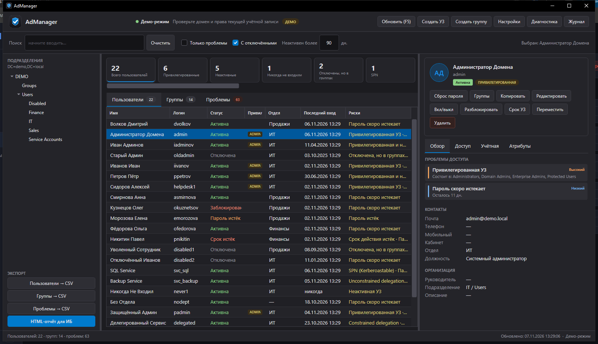

# AdManager — аудит доступов Active Directory

Настольное приложение для Windows (WPF, .NET 8) для повседневной работы службы
поддержки и информационной безопасности: обзор учётных записей и групп Active
Directory, поиск проблемных доступов, управление учётными записями и экспорт
отчётов.



## Возможности

### Аудит доступов
- Пользователи и группы домена, фильтры по OU, поиск, отображение отключённых УЗ.
- KPI-панель: привилегированные, неактивные, никогда не входившие, отключённые
  с группами, SPN, AS-REP, делегирование, SID History, пароли, пустые группы.
- Карточка пользователя: статус, контакты, организация, признаки безопасности,
  прямые и эффективные группы, проблемы доступа.
- Карточка группы: тип, область, владелец, вложенность, участники, атрибуты.
- Определение привилегированности по настраиваемому списку групп и well-known SID
  (`Administrators` = `S-1-5-32-544` и др.), поэтому локализованные группы
  «Администраторы» распознаются автоматически.
- Единый список проблем с важностью и деталями.

### Управление
- Включение/отключение, разблокировка, сброс пароля с генератором.
- Сброс возраста пароля (`pwdLastSet=-1`) без смены самого пароля.
- Требование смены пароля при следующем входе (`pwdLastSet=0`).
- Срок действия УЗ, флаг «пароль не истекает».
- Редактирование атрибутов, перемещение между OU, управление группами.
- Создание/удаление пользователей и групп.
- **Копирование УЗ** — создание новой учётной записи по образцу выбранной:
  переносятся группы, руководитель и атрибуты организации; новые ФИО, логин
  и пароль задаются в диалоге.
- Массовые операции по нескольким выбранным строкам.
- Подтверждение опасных операций, журнал действий, диагностика.

### Экспорт
- CSV (UTF-8 BOM, `;`) для пользователей, групп и проблем.
- HTML-отчёт для ИБ: сводка, проблемы, привилегированные пользователи, группы.

## Требования и права

- Windows 10/11 (x64).
- Домен Active Directory, доступный с рабочей станции.
- Для запуска: .NET 8 Desktop Runtime **или** self-contained сборка.
- Для чтения части атрибутов (статус УЗ, членство, сроки паролей) нужны права,
  достаточные для чтения объектов AD; часто требуется запуск от администратора.
- Для операций изменения — делегированные права на OU/объекты: изменение членства,
  сброс пароля, перемещение, создание/удаление.
- Для определения ПК последнего входа — право читать журнал `Security` на
  контроллере домена и включённый аудит входа/Kerberos.

Приложение собрано с манифестом `requireAdministrator`: Windows показывает UAC
при запуске. Если UAC отключён и пользователь не администратор, приложение
не сможет запуститься.

## Запуск

### Готовая сборка
Скачайте `AdManager-1.0.0-win64.zip` из раздела **Releases**, распакуйте и
запустите `AdManager.exe`. .NET устанавливать не нужно.

### Из исходников

```powershell
dotnet build AdManager.csproj
dotnet run --project AdManager.csproj
```

### Публикация

```powershell
dotnet publish AdManager.csproj -c Release -r win-x64 --self-contained true `
  -p:PublishSingleFile=true -p:IncludeNativeLibrariesForSelfExtract=true -o publish
```

## Демо-режим

Если домен недоступен, приложение автоматически переключается в демо-режим:
22 пользователя, 14 групп, тестовые проблемы. Изменения затрагивают только
демо-данные; перемещение объектов в демо-режиме отключено. Принудительно включить
демо-режим можно в «Настройках».

## Настройки

`%APPDATA%\AdManager\settings.json`:

- домен и контроллер домена;
- порог неактивности и горизонт истечения пароля;
- размер страницы LDAP и лимит объектов;
- список привилегированных групп;
- отображение отключённых УЗ и рекурсивный обход OU;
- выбор отображаемых проблем access review;
- длина генерируемого пароля и размеры окна.

## Журнал и диагностика

- `%APPDATA%\AdManager\audit\yyyy-MM.jsonl` — журнал операций.
  Кнопка «Журнал» открывает папку.
- `%APPDATA%\AdManager\diagnostics\AdManager-diag-*.txt` — отчёт по подключению,
  группам, атрибутам выбранной УЗ и ошибкам. Кнопка «Диагностика».

## ПК последнего входа

AD не хранит компьютер последнего входа в атрибутах пользователя. Приложение
best-effort определяет его по событиям `4624`/`4768` журнала `Security`
контроллера домена и показывает имя ПК или IP и время. Без прав на журнал или
аудита строка будет «не определён» / «нет прав на журнал Security».

## Структура проекта

```
AdManager.csproj
app.manifest
App.xaml / App.xaml.cs
MainWindow.xaml / MainWindow.xaml.cs
Themes/Dark.xaml
Common/          — MVVM-база, AD-преобразования, UAC-повышение прав
Converters/      — конвертеры WPF
Dialogs/         — кастомные диалоги и формы
Models/          — модели AD, настроек и access review
Services/        — живой AD, демо-режим, аудит, экспорт, диагностика
ViewModels/      — MainViewModel
Views/           — карточки пользователя и группы
Assets/          — иконка
```

## Ограничения

- Один домен за сеанс.
- Нет снимков состояния и отложенных отчётов.
- Пароли не сохраняются приложением.
- ПК последнего входа зависит от прав на журнал Security и политики аудита.
- Эффективные группы читаются через `tokenGroups`; группы из чужих доменов могут
  не разрешиться в имена.

## Лицензия

MIT. См. [LICENSE](LICENSE).

Автор: [@mr_sumin](https://t.me/mr_sumin)
